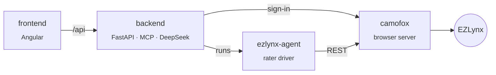

<div align="center">


# savvy-ai

**EZLynx Auto + Home quoting, run by an agent, approved by a human.**

[Quick start](#quick-start) · [How it fits](#how-it-fits) · [Safety](#safety) · [Design](DESIGN.md)

</div>

<br>

An agent asks for a quote in plain words. savvy-ai signs in to EZLynx, fills all sixteen
rater screens, validates them and brings back the carrier comparison. Nothing goes to a
carrier until a named person approves it.

## How it fits



| | |
|---|---|
| [`frontend/`](frontend/) | The workspace: sign in, connect EZLynx, chat with the quoting assistant. |
| [`backend/`](backend/) | Seals EZLynx credentials, handles the one-time code, and exposes the quoting tools over chat and MCP. |
| [`ezlynx-agent/`](ezlynx-agent/) | Fills the comparative rater from a selector map, verifies every field it writes, and parses results. |
| [`camofox/`](camofox/) | Camoufox behind a REST API. A fork of [jo-inc/camofox-browser](https://github.com/jo-inc/camofox-browser). |

## Quick start

You'll need **Node 22+**, **Python 3.11+** with [uv](https://docs.astral.sh/uv/), and **Docker**.

**1. Browser.** Starts on loopback only, with crash telemetry off. On Apple silicon, set `ARCH: arm64` in the compose file first.

```bash
cd ezlynx-agent && npm install && npm run build && docker compose up -d --build
```

Watch it live at [localhost:6080/vnc.html](http://localhost:6080/vnc.html).

**2. Backend.** Fill in `SAVVY_ENC_KEY` and `DEEPSEEK_API_KEY`, then add yourself as a user.

```bash
cd backend && cp .env.example .env
python3 -c "import secrets; print(secrets.token_hex(32))"   # → SAVVY_ENC_KEY
set -a && . ./.env && set +a
uv run python store.py add-user <name>
uv run uvicorn main:app --port 8000
```

**3. Frontend.** It proxies `/api` to the backend.

```bash
cd frontend && npm install && npm start
```

Open [localhost:4200](http://localhost:4200), connect EZLynx on the Connections page, and start quoting.

## Safety

The browser holds client PII and can trigger credit checks on real people. These guards
are built into the code, not left to policy:

- **Humans submit.** Only `submit_quotes` reaches carriers, and it requires `approved_by`.
- **Credit authorization has no default.** A run refuses to start without it.
- **Credentials are sealed** with AES-256-GCM, bound to the user. The one-time code is never stored.
- **Logs redact at the source.** The LLM only sees the field it's resolving, never names, SSNs, DOBs or VINs.
- **camofox stays on loopback** with crash telemetry off. The agent refuses to run with telemetry on.
- **Client recordings stay local.** `data/` is gitignored.

## Tests

```bash
cd backend && uv run pytest
cd ezlynx-agent && npm test
```

Neither suite touches EZLynx, a carrier or DeepSeek.

<br>

<div align="center"><sub>camofox is MIT-licensed, from <a href="https://github.com/jo-inc/camofox-browser">jo-inc/camofox-browser</a>.</sub></div>
